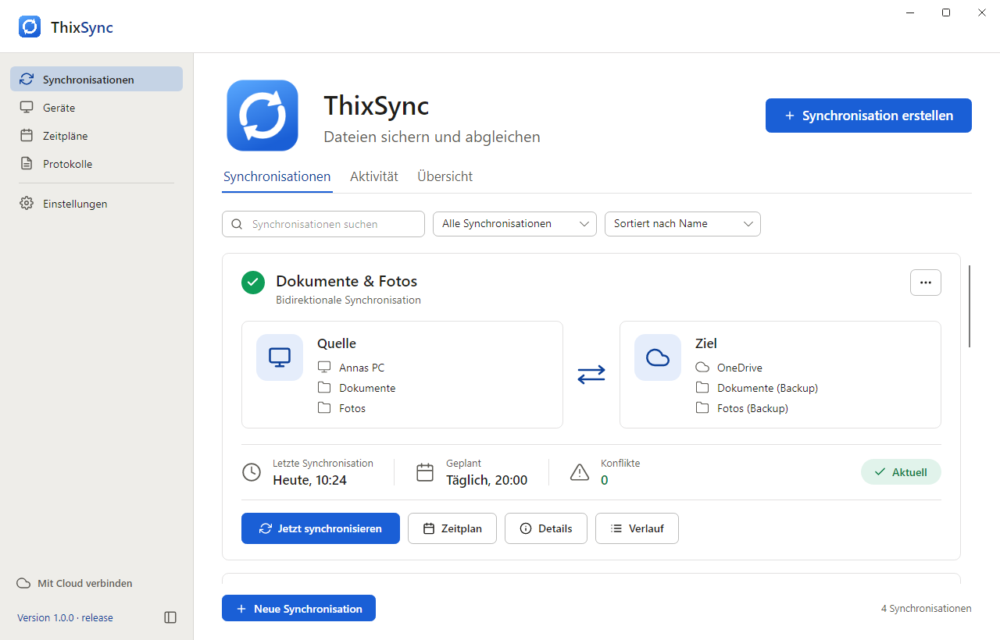

<p align="center"></p>

# ThixSync

Synchronisation und Backup für **Windows und macOS** – Teil der ThixApps. ThixSync hält Ordner zwischen Computer, USB-Laufwerk,
NAS, Server und Cloud gleich: **bidirektional**, als **Spiegel** oder als **Backup mit Versionen**. Konflikte erkennt es, alle
Änderungen zeigt es vorher in einer Vorschau, und Aufträge laufen von Hand, nach Zeitplan oder automatisch bei Änderungen – mit
Fortschritt, Geschwindigkeit (MB/s **und** Dateien/s) und Protokoll. Viele kleine Dateien kopiert ThixSync parallel.



## Quellen und Ziele

Jeder Typ kann Quelle **und** Ziel sein – in jeder Kombination.

| Gruppe | Typen |
|---|---|
| **Lokal & Netzwerk** | Dieser Computer (Windows/macOS), externe Festplatten / USB-Laufwerke (erkannt an der Kennung, nicht am Buchstaben), SMB / CIFS, NFS, Synology NAS, QNAP NAS |
| **Server & Protokolle** | SFTP / SSH, FTP / FTPS, WebDAV / HTTPS, rsync über SSH, Hetzner Storage Box |
| **Cloud-Speicher** | Amazon S3 / S3-kompatibel, Google Drive, Microsoft OneDrive, SharePoint, Dropbox, Nextcloud / ownCloud, Backblaze B2, Wasabi, Azure Blob Storage, Google Cloud Storage, MEGA, pCloud, Box, Seafile |
| **ThixApps** | ThixSync Remote (PC zu PC, verschlüsselt, mit Kopplungscode), MatCloud / ThixCloud (ThixDrive) |

## Funktionen

- **Aufträge** mit einem oder mehreren Ordnerpaaren je Quelle und Ziel, Filtern (Muster, versteckte Dateien, Größe, Alter),
  Konfliktregeln (fragen, neuere gewinnt, Quelle/Ziel gewinnt, beide behalten), Versionen in `.thixsync/versions`,
  Erkennung von Umbenennungen, Prüfung nach dem Kopieren und einer Sicherheitsgrenze gegen Massenlöschungen.
- **Vorschau** (Analyse) mit allen geplanten Änderungen; Konflikte einzeln lösen.
- **Zeitpläne:** Intervall, täglich, wöchentlich, beim Start, bei Änderungen (lokale Ordner werden überwacht), verpasste Läufe nachholen.
- **Schnell:** zwei Bahnen – kleine Dateien mit voller Parallelität, große in Stücken –, Kopien mit dem Betriebssystem zwischen
  lokalen Ordnern, Anpassung an Ratenlimits der Clouds, globale Bandbreitengrenze.
- **Protokolle** jedes Laufs, durchsuchbar und filterbar.
- **MatCloud:** Aufträge und Verbindungen (ohne Passwörter) auf allen Computern gleich.
- **Kommandozeile** `thixsync-cli` (list, run, status, runs, log, connections, test, pause, resume, export, import).
- **Setup, Autostart, Updates:** eigenes Setup, Start bei der Anmeldung, Updates über das Internet (auf Wunsch vollautomatisch);
  installierbar und aktualisierbar über den **ThixLauncher**.

## Installation

- **ThixLauncher** (empfohlen): ThixSync im Store installieren – Updates kommen von dort.
- **Windows:** `ThixSyncSetup.exe` aus dem Release `release-channel` (Nightly: `nightly-channel`).
- **macOS:** `ThixSync-macOS-arm64.dmg` / `-x64.dmg`.
- **Nur die Kommandozeile:** `ThixSync-CLI-win-x64.zip`, `ThixSync-CLI-macOS-{arm64,x64}.tar.gz`.

## Kommandozeile

```
thixsync-cli list
thixsync-cli run "Dokumente & Fotos" --preview
thixsync-cli run "Dokumente & Fotos"
thixsync-cli runs --job "Dokumente & Fotos" --limit 5
thixsync-cli help
```

Exit-Codes: 0 erfolgreich, 1 Warnungen/Konflikte, 2 fehlgeschlagen, 3 falscher Aufruf, 4 nicht gefunden, 5 abgelehnt, 130 abgebrochen.

## Entwicklung

```
dotnet build ThixSync.slnx
dotnet test ThixSync.slnx
dotnet run --project src/ThixSync
dotnet run --project src/ThixSync -- --snapshot docs/images
```

Versionen: Release `<major>.<minor>.<build>-<datum>` (Branch `main`), Nightly `nightly-<build>-<datum>` (Branch `dev`), lokal
`local-<datum>`. Für Google Drive, OneDrive, SharePoint, Dropbox und Box braucht der Build App-Registrierungen:
[docs/APP-REGISTRIERUNG.md](docs/APP-REGISTRIERUNG.md). Aufbau und Regeln: [CLAUDE.md](CLAUDE.md).

© Matthias Schmoldt
